# Confronti visuali UX — inventario

Le quattro tavole sono state prodotte per confrontare le scelte delle serie v1 (3 mockup) e v2 (9 mockup). La decisione sintetica è in [UX Baseline v0.2](../UX_Baseline_v0.2.md).

| ID | Tavola originale e anteprima | Confronto | Stato |
| --- | --- | --- | --- |
| CMP-01 | <a href="01_workspace_affiancamento.jpg">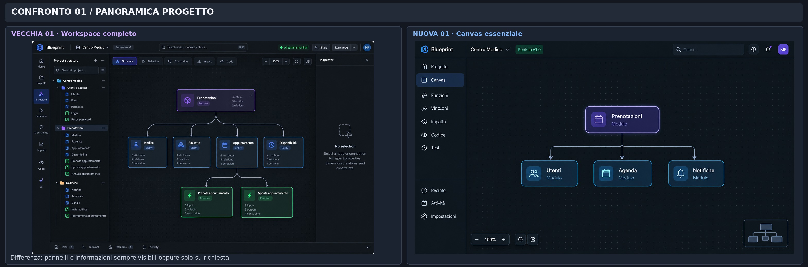</a> JPEG · 3140 × 1040 | v1-01 vs v2-01: struttura dell'ambiente e canvas | **Importato e verificato** |
| CMP-02 | <a href="02_entita_affiancamento.jpg">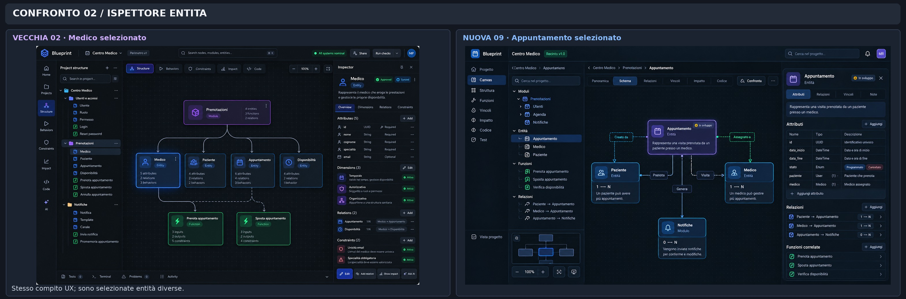</a> JPEG · 3140 × 1040 | v1-02 vs v2-09: ispezione entità | **Importato e verificato** |
| CMP-03 | <a href="03_relazioni_affiancamento.jpg">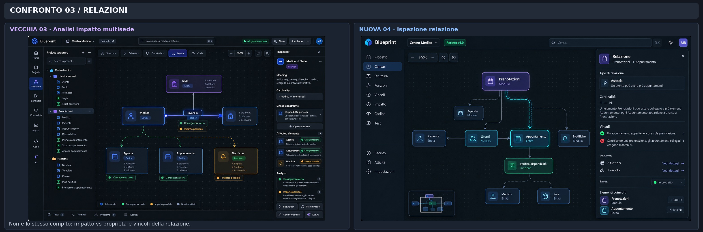</a> JPEG · 3140 × 1040 | v1-03 vs v2-04: impatto vs ispezione relazione | **Importato e verificato** |
| CMP-04 | <a href="04_nuove_schermate_panorama.jpg">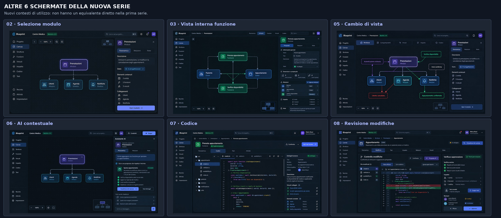</a> JPEG · 2970 × 1295 | Sei situazioni aggiuntive presenti soltanto in v2: 02, 03, 05, 06, 07, 08 | **Importato e verificato** |

## Originali affiancati nei confronti

Le celle mostrano direttamente i PNG delle due serie; le tavole JPG sopra sono composizioni già presenti nello ZIP, non nuove elaborazioni. Gli oggetti selezionati in CMP-02 sono diversi (Medico in v1, Appuntamento in v2): il confronto riguarda l'ispezione e il contesto, non l'identità del contenuto.

| Confronto | Prima serie | Seconda serie |
| --- | --- | --- |
| CMP-01 — workspace | <a href="../references/v1/01_workspace_panoramica.png">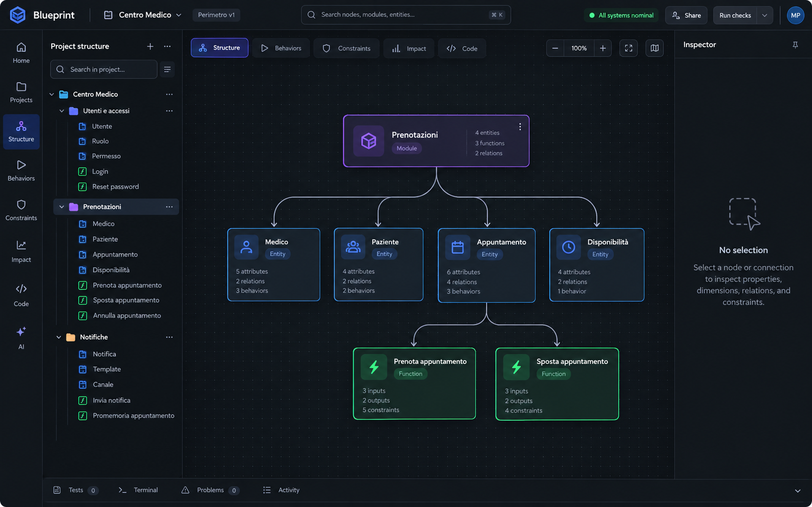</a> | <a href="../references/v2/01_workspace_iniziale.png">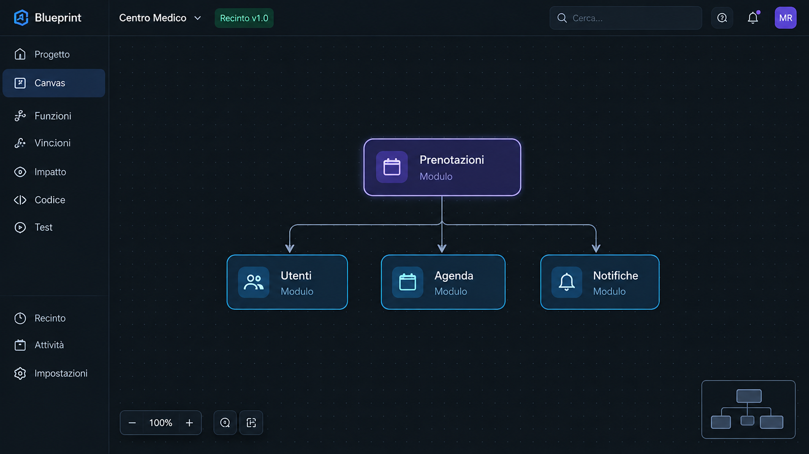</a> |
| CMP-02 — ispezione entità | <a href="../references/v1/02_entita_selezionata.png">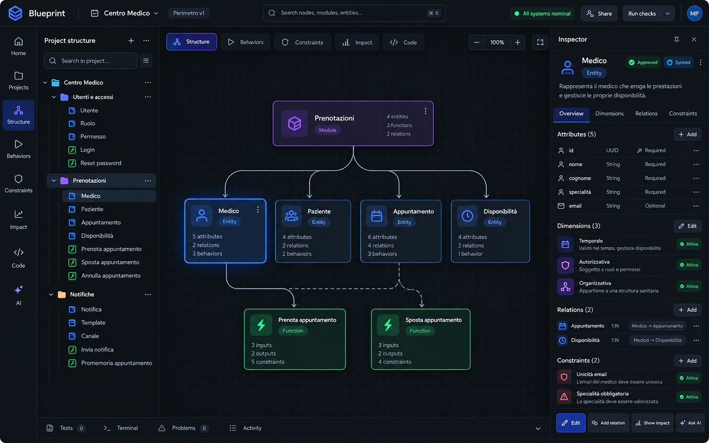</a> | <a href="../references/v2/09_navigazione_contesto.png">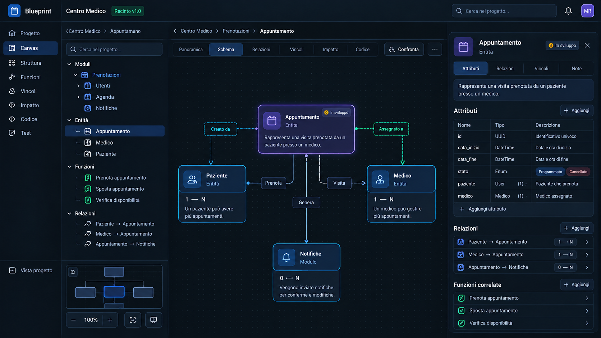</a> |
| CMP-03 — impatto e relazione | <a href="../references/v1/03_relazione_impatto.png">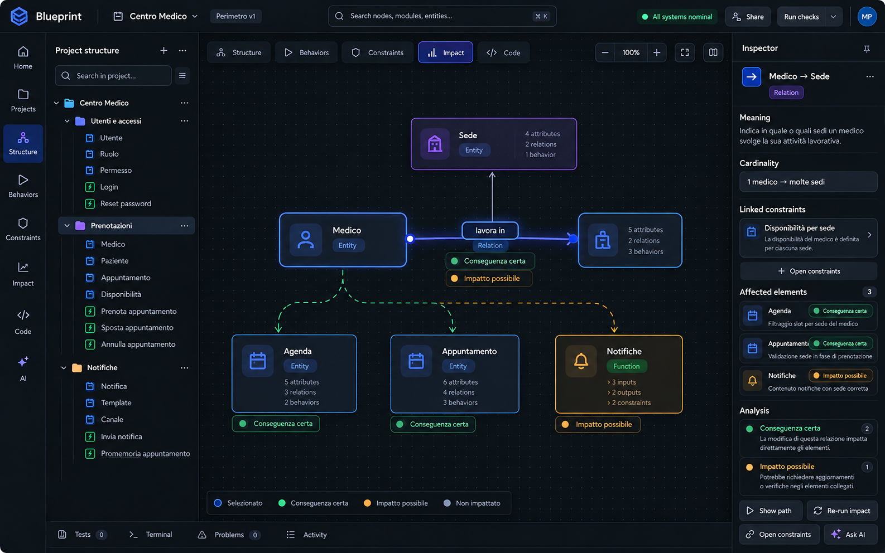</a> | <a href="../references/v2/04_ispezione_relazione.png">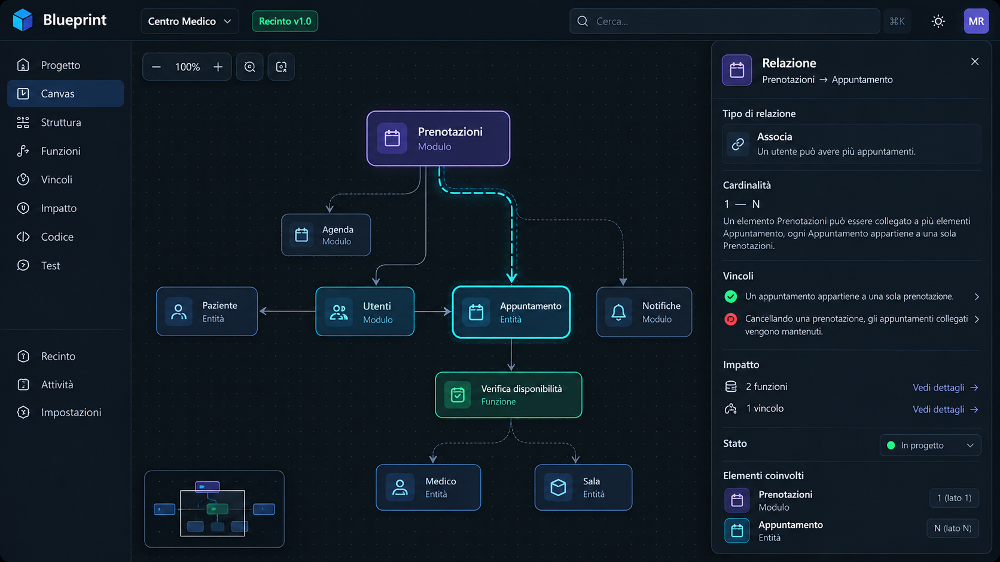</a> |

## Situazioni aggiuntive della seconda serie

Queste sei schermate sono riferimenti esplorativi, non nuove decisioni né funzionalità implementate. Per decisioni e questioni aperte fa fede la Baseline v0.2, preservata integralmente.

| Reference originale | Situazione esplorata | Stato UX |
| --- | --- | --- |
| <a href="../references/v2/02_selezione_elemento.png">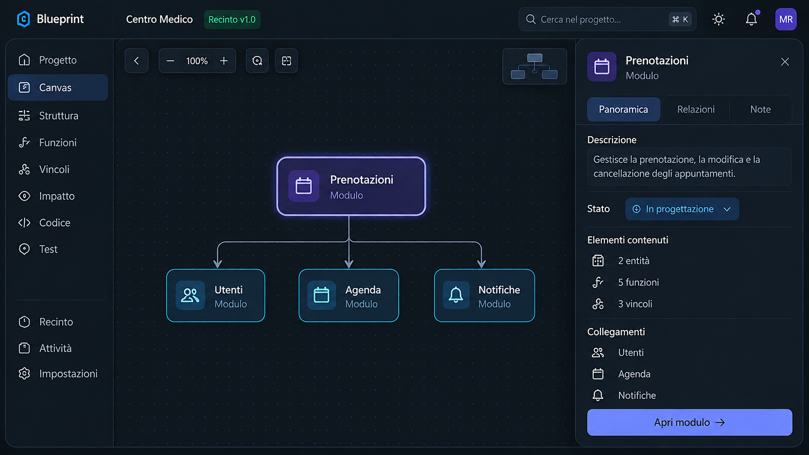</a> | Ispezione rapida del modulo | Esplorativa |
| <a href="../references/v2/03_dettaglio_elemento.png">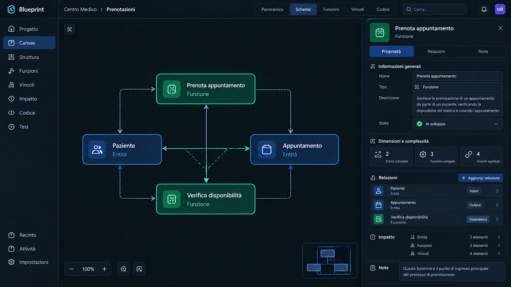</a> | Navigazione interna e contesto | Esplorativa |
| <a href="../references/v2/05_cambio_vista.png">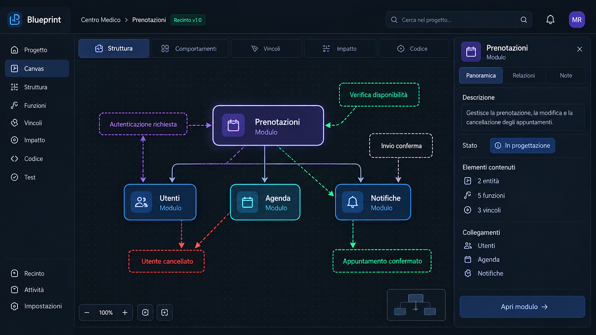</a> | Cambio di prospettiva | Esplorativa |
| <a href="../references/v2/06_ai_contestuale.png">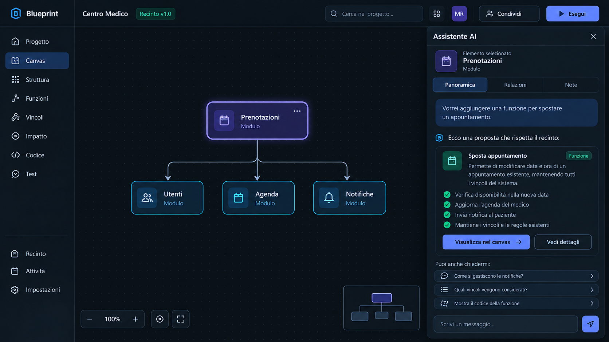</a> | Assistenza sulla selezione | Esplorativa |
| <a href="../references/v2/07_implementazione.png">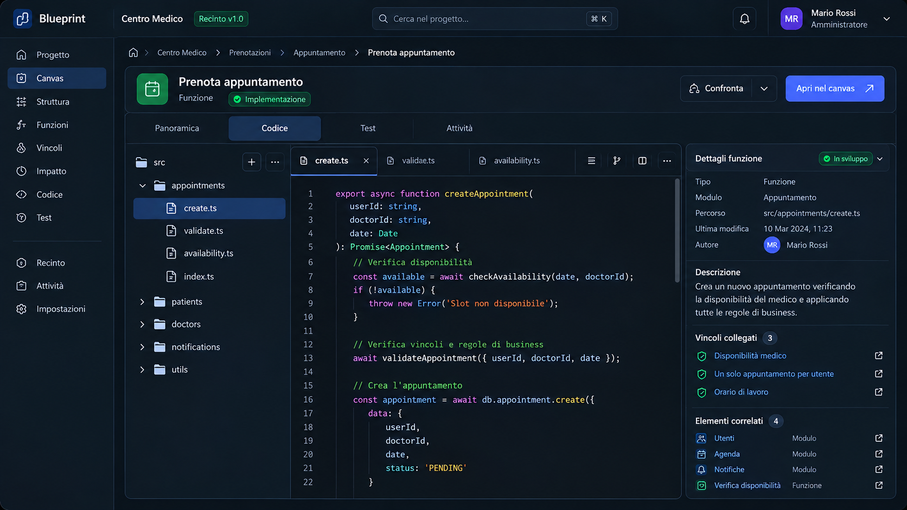</a> | Codice associato alla funzione | Esplorativa |
| <a href="../references/v2/08_revisione_modifiche.png">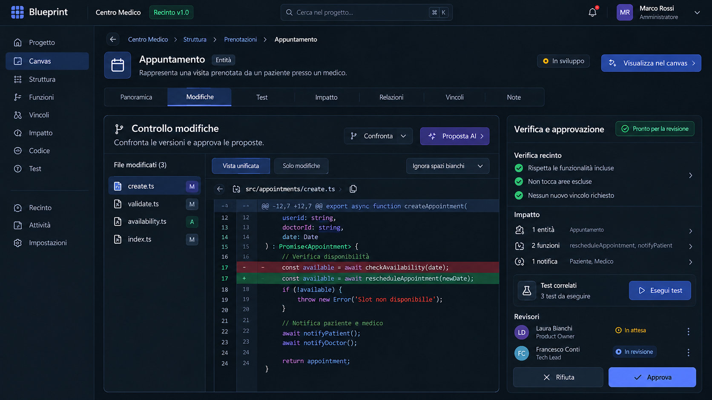</a> | Diff, evidenze e approvazioni | Esplorativa |

**Stato delle 4 tavole: IMPORTATE E VERIFICATE nel repository locale.** Fonte: `Blueprint_UX_Documentazione_Visuale_Completa.zip`. Corrispondenze controllate visivamente e file conservati byte per byte; nomi sorgenti e SHA-256 nel [rapporto di importazione](../IMPORTAZIONE_VISUALI.md). Questo stato non attesta una pubblicazione su GitHub. Gli asset non vanno ricreati o sostituiti con altre immagini.
